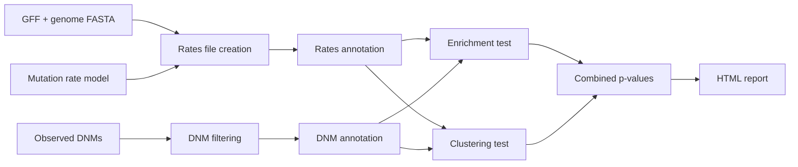

# DeNovoWEST

!!! warning "Beta documentation"
    This documentation describes **DeNovoWEST 2.0.0-beta**, developed on the
    [`develop`](https://github.com/HurlesGroupSanger/DeNovoWEST/tree/develop) branch.
    Options and output formats may still change before the 2.0.0 release.
    The method as published in 2020 is available on the
    [`v1.0.0`](https://github.com/HurlesGroupSanger/DeNovoWEST/tree/v1.0.0) branch.

**DeNovoWEST** (*De Novo* Weighted Enrichment Simulation Test) tests whether genes carry
more damaging *de novo* mutations (DNMs) than expected by chance in a cohort of
parent–offspring trios.

It combines two complementary gene-level tests:

- an **enrichment test**, which compares the observed burden of DNMs in a gene,
  weighted by a variant severity score, against a gene-specific null distribution built
  from expected mutation rates;
- a **clustering test** (via [denovonear](https://github.com/jeremymcrae/denovonear)),
  which asks whether missense DNMs are more clustered than expected along the protein
  sequence or in its 3D structure.

The original method is described in
[Kaplanis, Samocha, Wiel, Zhang *et al.*, *Nature* 2020](https://www.nature.com/articles/s41586-020-2832-5).

## What you get

DeNovoWEST 2 is distributed as:

- a **Nextflow workflow** (`nextflow/`) that runs the full analysis, from building a
  mutation rates file to producing gene-level p-values;
- a **Python package and command-line tool** (`denovowest`) exposing the individual
  steps (annotation, enrichment simulation, report).

## Where to go next

- **[Installation](getting-started/installation.md)**: set up the conda environment, a container or the Python package.
- **[Quick start](getting-started/quickstart.md)**: run the whole workflow on the bundled toy dataset in a few minutes.
- **[What's new in v2](getting-started/whats-new.md)**: what changed since the 2020 publication.
- **[Configuration reference](user-guide/configuration.md)**: every workflow parameter.
- **[Method](method/concepts.md)**: how the tests work.
- **[Command-line interface](reference/cli.md)**: run individual steps without Nextflow.

## Getting help

Please report bugs and ask questions on the
[GitHub issue tracker](https://github.com/HurlesGroupSanger/DeNovoWEST/issues).
If you use DeNovoWEST in your work, please [cite it](citation.md).
