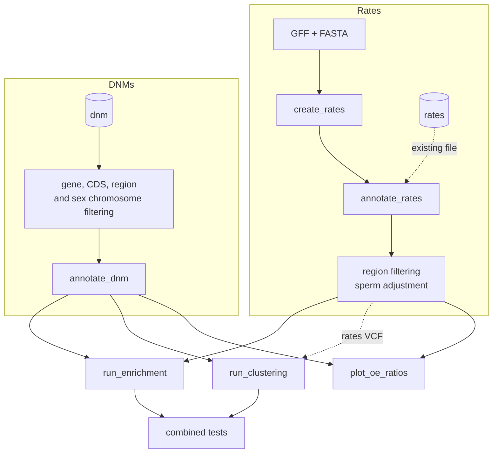

# Workflow overview

The Nextflow workflow chains the steps of a DeNovoWEST analysis. Each step is switched on
with a [mode flag](configuration.md#modes), so you can run everything at once or one
step at a time, reusing earlier outputs.

<!-- Diagram hidden until finalised: remove the div below to show it again -->

## Steps

### 1. Rates file creation (`create_rates`)

Lists every possible single-nucleotide substitution in the coding sequence and splice
regions of each gene in the GFF, and assigns it an expected mutation rate from a
mutation rate model (trinucleotide `kmer`, Roulette or Carlson).
See [Mutation rates](../method/rates.md).

Skip this step by giving an existing rates file with `rates`.

### 2. Annotation (`annotate_rates`, `annotate_dnm`)

Adds the same annotations to the rates file and the DNM file:

- the predicted **consequence** of each variant (bcftools csq), used to select variants
  for each test;
- one or more **variant scores** (CADD, dbNSFP scores such as AlphaMissense or REVEL,
  popEVE…), one of which is used as the severity score by the enrichment test;
- gene-level information such as constraint metrics.

Then, for the rates file:

- variants in `excluded_regions` are removed;
- mutation rates can be adjusted for genes under positive selection in the male
  germline (`sperm_positive_selection_adjustment`);
- a VCF version of the rates is written, which the clustering test can use.

### 3. DNM filtering

Before annotation, DNMs are kept only if they fall in a gene of the gene list and in
its coding sequence or splice region. DNMs in `excluded_regions` and, optionally, on sex
chromosomes are removed. Discarded DNMs are written to `dnm/dnms_discarded.tsv` with the
reason.

### 4. Enrichment test (`run_enrichment`)

For each gene, compares the sum of the scores of the observed DNMs with its distribution
under the null hypothesis, obtained by simulation from the rates file. Run on all coding
variants, on missense variants only, or both.
See [Enrichment test](../method/enrichment.md).

### 5. Clustering test (`run_clustering`)

Tests whether missense DNMs cluster along the protein sequence (`linear`) or in the
predicted 3D structure (`3D`), using denovonear.
See [Clustering test](../method/clustering.md).

### 6. Combined tests

When both tests run (with enrichment `runtype = "both"`), the missense enrichment and
clustering p-values are combined, and the minimum of this combined p-value and the
all-coding enrichment p-value is reported for each gene.
See [Concepts](../method/concepts.md#combining-the-tests).

### 7. Quality control (`plot_oe_ratios`)

Compares observed and expected numbers of DNMs per consequence, overall and per gene
category, to check that the mutation rate model is calibrated for your cohort.

## Parallelisation

Genes are split into batches of `split_step` genes (default 100). Rates creation,
annotation, enrichment and clustering run as one job per batch, and the results are
merged at the end of each step.

## Typical ways of running it

| Goal | Modes | Inputs |
|------|-------|--------|
| Everything from scratch | all | `gff`, `genome_fasta`, `dnm`, `rates_creation`, `annotation`, `enrichment`, `clustering` |
| Build an annotated rates file once, for several cohorts | `create_rates`, `annotate_rates` | `gff`, `genome_fasta`, `rates_creation`, `annotation` |
| Analyse a new cohort with an existing rates file | `annotate_dnm`, `run_enrichment`, `run_clustering` | `rates`, `dnm`, `gff`, `genome_fasta`, `annotation`, `enrichment`, `clustering` |
| Try other enrichment settings | `run_enrichment` | annotated `rates` and `dnm` from a previous run |

See [Recipes](recipes.md) for complete examples.
